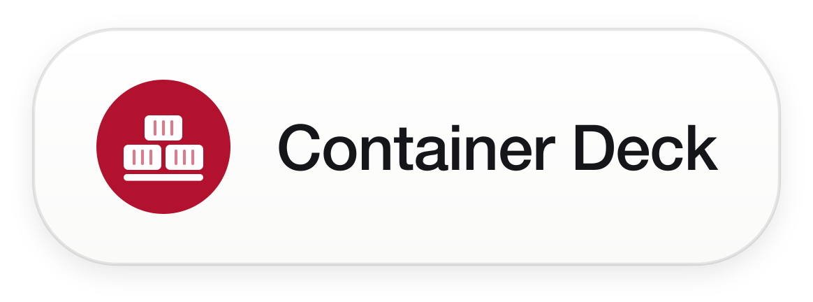
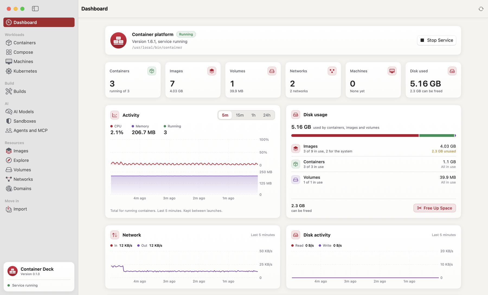
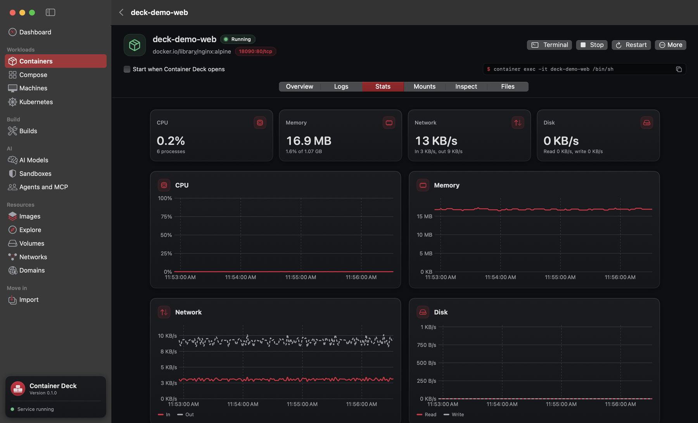
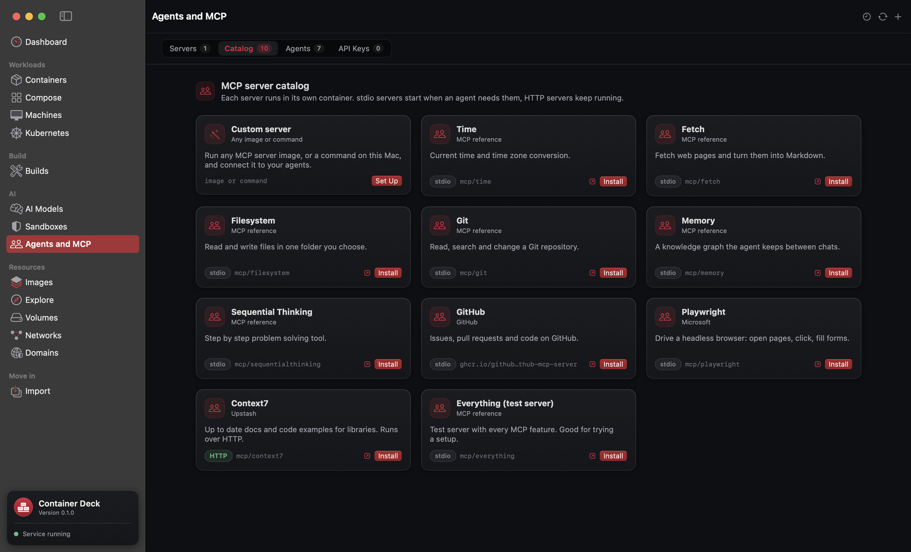
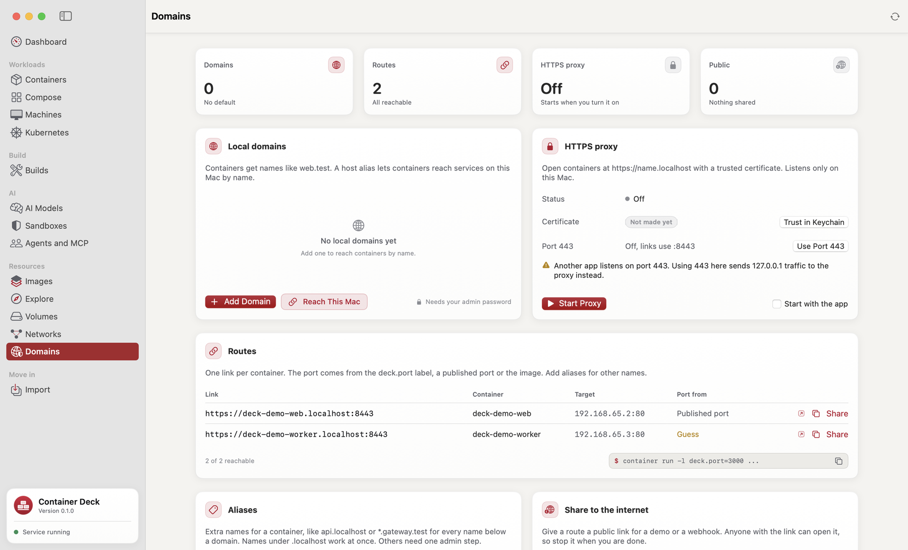
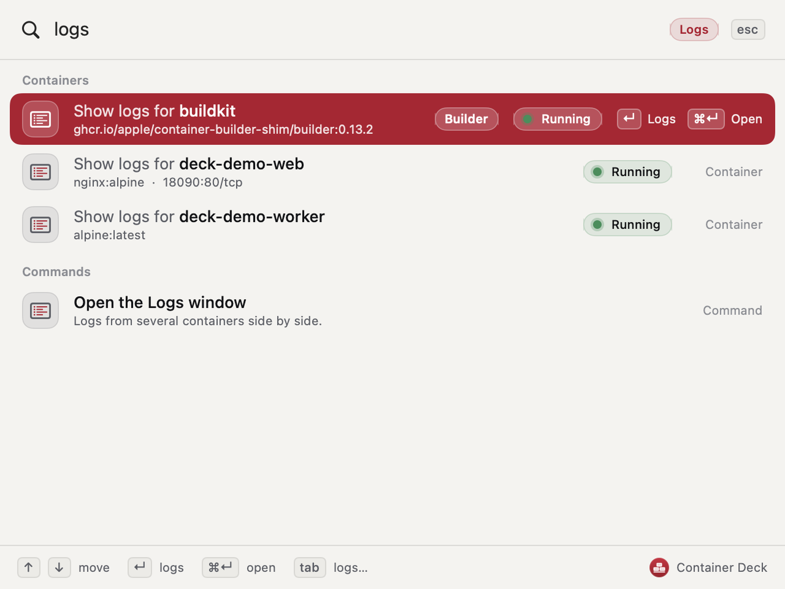
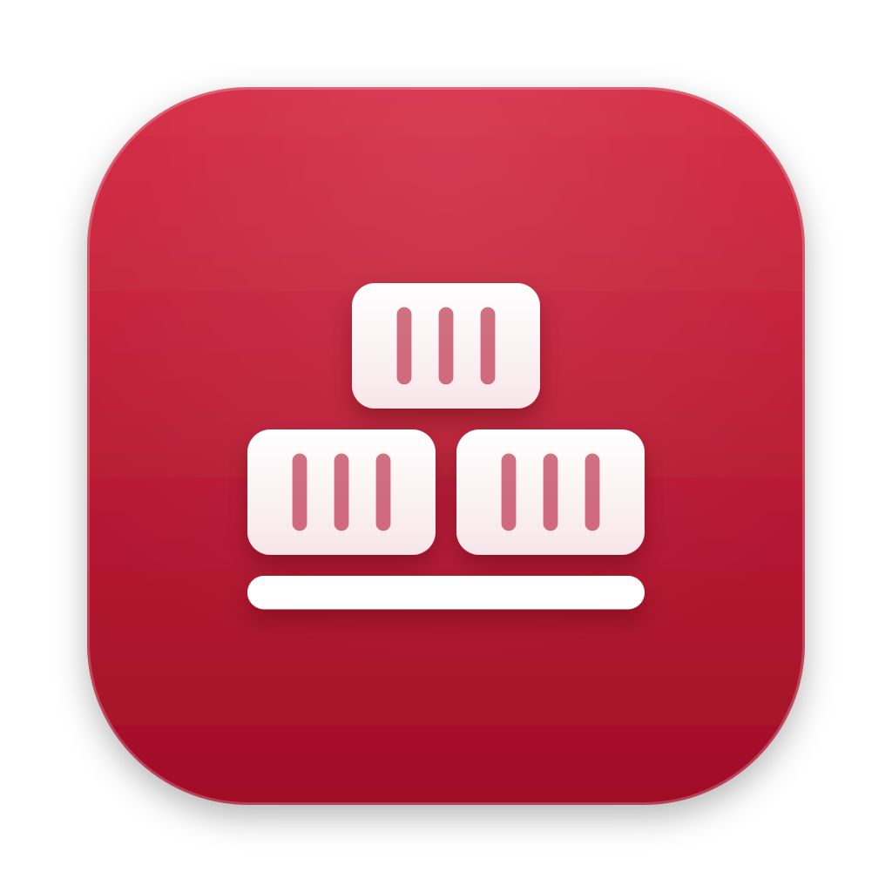

<p align="center">
  <a href="https://github.com/sur950/container-deck">
    <picture>
      <source media="(prefers-color-scheme: dark)" srcset="assets/brand/lockup-dark.png">
      
    </picture>
  </a>
</p>

<h3 align="center">The native Mac app<br>for Apple's container platform.</h3>

<p align="center">Run, build and manage Linux containers on Apple silicon. Compose, Kubernetes, local AI, MCP servers and HTTPS domains in one fast SwiftUI app. Free, no account, an 8 MB download.</p>

<p align="center">
  <a href="https://github.com/sur950/container-deck/releases/latest"></a>
  <a href="https://github.com/sur950/container-deck/releases"></a>
  <a href="https://github.com/sur950/container-deck/actions/workflows/ci.yml"></a>
  
  
  <a href="LICENSE"></a>
</p>

<p align="center">
  <a href="https://github.com/sur950/container-deck/releases/latest"><strong>Download for Mac</strong></a>
  &middot; <a href="#install">Install with one line</a>
  &middot; <a href="#features">Features</a>
  &middot; <a href="#container-deck-vs-davit-vs-orchard">Compare</a>
  &middot; <a href="docs/DOCKER.md">Docker commands</a>
  &middot; <a href="#faq">FAQ</a>
</p>

<p align="center">
  <picture>
    <source media="(prefers-color-scheme: dark)" srcset="docs/screenshots/dashboard-dark.png">
    
  </picture>
</p>

## Install

Container Deck runs on any Mac with Apple silicon and macOS 15 or later. If Apple's [`container`](https://github.com/apple/container) platform is not on your Mac yet, the app installs it on first launch.

### One line in Terminal

```bash
curl -fsSLO https://github.com/sur950/container-deck/releases/latest/download/ContainerDeck.pkg && sudo installer -pkg ContainerDeck.pkg -target /
```

This downloads the installer package from the latest GitHub release and installs Container Deck into Applications. Files downloaded with `curl` carry no quarantine flag, so macOS opens the app without a security prompt. `sudo` asks for your password because the package writes to `/Applications`.

To check the download first, fetch the checksum that ships with every release:

```bash
curl -fsSLO https://github.com/sur950/container-deck/releases/latest/download/ContainerDeck.pkg.sha256
shasum -a 256 -c ContainerDeck.pkg.sha256
```

For a specific version, replace `latest/download` with `download/v1.0.0`.

Downloaded `ContainerDeck.pkg` in a browser instead? macOS blocks packages that are not notarized when you double click them. Install it from Terminal with `sudo installer -pkg ~/Downloads/ContainerDeck.pkg -target /`, or open **System Settings**, **Privacy & Security** and click **Open Anyway** next to "ContainerDeck.pkg was blocked".

### Download the disk image

1. Download [`ContainerDeck.dmg`](https://github.com/sur950/container-deck/releases/latest/download/ContainerDeck.dmg) from the latest release.
2. Open it and drag Container Deck to Applications.
3. Open the app once as shown in [First launch](#first-launch).

Every release ships a `.sha256` file next to the disk image. From then on the app updates itself and checks each update's Ed25519 signature before it installs it.

### First launch

Releases are signed with the Container Deck code signing certificate. They are not notarized by Apple, so the first time you open a downloaded copy, macOS says it cannot check Container Deck for malicious software. To open it:

1. Click **Done** in the message.
2. Open **System Settings**, then **Privacy & Security**.
3. Next to "Container Deck was blocked", click **Open Anyway** and confirm.

Or run this once in Terminal:

```bash
xattr -dr com.apple.quarantine "/Applications/Container Deck.app"
```

You only do this once. The one line installer and in app updates handle it for you.

## Why Container Deck

Apple's `container` runs every Linux container in its own lightweight VM, natively on Apple silicon. Container Deck puts all of it in one Mac app, from the first install to the last log line.

- **Fast.** Talks to Apple's container service directly over XPC. Lists take about 4 ms and live stats about 20 ms, with no helper processes while you browse. The `container` command is the automatic fallback.
- **Native.** SwiftUI, SF Symbols, Light and Dark, keyboard first, menu bar control. No Electron, no web view, no account.
- **Light.** An 8 MB download, about 20 MB installed. No server and no daemon of its own.
- **Honest.** Every action can show the exact `container` command it runs, so you can learn it or put it in a script.
- **Private.** No analytics and no tracking. API keys and registry passwords live in your Keychain.

## Features

### Containers and images

- **Lifecycle.** Run, stop, restart, delete and recreate. Recreate never loses the old container: it comes back automatically if the new one fails.
- **Live stats.** CPU, memory, network and disk charts, with history kept between launches.
- **Logs and files.** Streaming logs with search, a multi pane Logs window, a file browser with upload and download, a Mounts tab, and a shell in your terminal app.
- **Images.** Pull with progress, build from any Dockerfile, tag, save and prune. Search Docker Hub or pull from any registry you sign in to.
- **Organize.** Group by Compose project or label, act on many at once, export to tar, commit to an image.

<p align="center"></p>

### Builds, Compose and machines

- **Builds.** Every build with its live BuildKit log. Run several at once, stop, rebuild, and keep the history across restarts. See the build cache size and clean it up.
- **Compose.** Open a `compose.yaml`, with override files if you use them, and run the stack. Healthchecks, profiles, `depends_on` conditions, `post_start` and `pre_stop` hooks, per service logs, and re-up of only what changed. A Problems tab points to the exact line, and `container compose` works in Terminal too. Coming from Docker Compose? See [what works and what does not](docs/COMPOSE.md#coming-from-docker-compose).
- **Machines.** Lightweight Linux VMs with your Mac user and home folder, live stats, and Apply and Restart.

### AI on your Mac

- **AI Models.** Finds Ollama, LM Studio and MLX servers, installs the MLX runtime in one click, downloads models from Hugging Face with resume, and has a chat tester.
- **Sandboxes.** Isolated containers for AI agents with a workspace folder, CPU and memory limits, an allow list of sites, model access and a kill switch.
- **Agents and MCP.** Sees every MCP server already set up on your Mac, runs MCP servers as containers, and connects them to Claude Code, Claude Desktop, Cursor, VS Code, Codex and Gemini in one click. You get a preview, a backup and Undo.

<p align="center"></p>

### Networking and Kubernetes

- **Domains.** HTTPS for `https://<container>.localhost` through a built in proxy with its own certificate authority. Add aliases, reach this Mac by name, and share a route to the internet in one click through Cloudflare Tunnel, ngrok or Tailscale Funnel. Pick whichever your network allows.
- **Networks and volumes.** Create, browse and clean up, including host only networks.
- **Kubernetes.** Local clusters on `container cluster` with nodes, kubeconfig, workloads, live pod logs, restarts and port forwards. Cluster networking is repaired automatically after a stop and start.

<p align="center"></p>

### Everywhere

- **Command palette.** Press <kbd>⌘</kbd> <kbd>K</kbd> and type "stop db", "logs api" or "pull redis:7".
- **Menu bar.** Service status, usage rings, and start and stop for each container. It keeps running when the window is closed and can open at login.
- **Import.** Bring images over from Docker Desktop, OrbStack, Rancher Desktop, Podman and Colima, even when those apps are stopped.
- **Notifications.** Hear about a stack that is up, a pull or build that finished, or a container that stopped on its own.
- **Setup and updates.** A first run guide installs Apple's platform, and the app updates itself from signed releases.
- **Diagnostics.** Versions, backend, recent errors, and one click to copy them into a bug report.

<p align="center"></p>

## Container Deck vs Davit vs Orchard

Davit and Orchard are good, free apps for the same platform, and both are worth a look. Here is how the three compare today.

🟢 Yes &nbsp; 🟠 Partly, with what is there and what is not &nbsp; 🔴 No

| | Container Deck | Davit | Orchard |
|---|---|---|---|
| macOS version | 15 or later | 15 or later | 26 only |
| Talks to Apple's container service directly | 🟠 Lists, stats, start and stop, logs, images, volumes and networks. Run, build and pull use the CLI. | 🟢 | 🟠 Most calls. System start and stop, the builder, DNS and clusters use the CLI. |
| Falls back to the `container` CLI | 🟢 | 🔴 | 🔴 |
| File browser in containers | 🟢 | 🟢 | 🔴 |
| Registry sign in inside the app | 🟢 | 🟢 | 🔴 Shows a CLI command to copy |
| Build history | 🟢 | 🔴 | 🟢 |
| Multi pane logs | 🟢 | 🔴 | 🟢 |
| Machines | 🟢 | 🟠 Create, start, edit CPU and memory, logs and stats. No nested virtualization, kernel or account options. | 🟢 |
| Kubernetes clusters | 🟢 | 🔴 | 🟠 Clusters, nodes, CNI, image loading and kubeconfig. No workloads view, pod logs or port forwards. |
| Local AI models | 🟢 | 🔴 | 🟠 Finds model servers, runs the MLX server, chat tester. No model library or downloads. |
| Sandboxes for AI agents | 🟢 | 🔴 | 🟠 Lists sandboxes with isolation badges and a kill switch. A separate app creates them. |
| MCP servers and agent connections | 🟢 | 🔴 | 🔴 |
| Local domains | 🟢 | 🟠 Create domains and set the default. No aliases. | 🟢 |
| HTTPS proxy and internet sharing (Cloudflare, ngrok, Tailscale) | 🟢 | 🔴 | 🔴 |
| Import from other engines, even stopped | 🟢 | 🔴 | 🔴 |
| Compose healthchecks and profiles | 🟢 | 🟢 | 🔴 |
| Compose `depends_on` conditions | 🟢 | 🟢 | 🟠 Start order only. Health and completion conditions are refused. |
| Compose hooks | 🟢 | 🔴 | 🟠 The `container compose` plugin runs them. Orchard's Compose tab does not. |
| Compose in Terminal | 🟢 `container compose` with up, down, ps, logs, exec, start, stop, restart, pull and config | 🟠 Its own `Davit compose` command, not `container compose` | 🟠 `container compose` with up and down only |
| Notifications | 🟢 | 🟠 Unexpected stops only | 🔴 |
| Open at login | 🟢 | 🟢 | 🔴 |
| Command palette with verbs | 🟢 | 🟠 Search only, no verbs | 🟢 |
| Menu bar | 🟢 | 🟢 | 🟢 |
| Signed updates | 🟢 | 🟢 | 🟢 |
| Notarized by Apple | 🔴 Signed with our own certificate | 🟢 | 🟢 |
| Install | Installer package with `curl`, or DMG | Homebrew or DMG | Homebrew or DMG |
| License | Apache 2.0 + Commons Clause | MIT | MIT |
| Price | Free | Free | Free |

<sub>Checked on 6 November 2026 against Davit 0.1.39 and Orchard 2.6.1, from their websites and source code. If something here is out of date, please <a href="https://github.com/sur950/container-deck/issues">open an issue</a> and we will fix it.</sub>

## Use Docker commands

Years of `docker run` are hard to unlearn, and you do not have to. The [Docker compatibility guide](docs/DOCKER.md) shows how to use Docker commands with Apple's container: which ones map one to one, which flags change, aliases you can paste into your shell, and a `docker` command for scripts and Makefiles that expect one. Apple's platform does not offer the Docker Engine API, so tools that talk to the Docker socket directly still need Docker.

## How it works

```text
SwiftUI app (Sources/ContainerDeck)
   │
   ▼
DeckCore (Sources/DeckCore, no UI, fully tested)
   ├── Direct XPC client ──▶ Apple container API server   lists, stats, start/stop, logs, images, volumes, networks
   └── container CLI ──────▶ everything else, and the automatic fallback
```

Container Deck has no server of its own. It talks to the services Apple's `container` platform already runs on your Mac. Hot paths such as the container list and live stats go straight to Apple's API server over XPC. Everything else runs the `container` command, which is also the fallback when the API is out of reach. [docs/ARCHITECTURE.md](docs/ARCHITECTURE.md) has the full picture.

## Keyboard

| Shortcut | Action |
|---|---|
| <kbd>⌘</kbd> <kbd>K</kbd> | Command palette |
| <kbd>⇧</kbd> <kbd>⌘</kbd> <kbd>R</kbd> | Run the setup checks again |
| <kbd>⌥</kbd> <kbd>⌘</kbd> <kbd>D</kbd> | Diagnostics |
| <kbd>⌘</kbd> <kbd>A</kbd>, <kbd>Delete</kbd>, <kbd>Space</kbd> | Select all, delete and open in container lists |
| <kbd>⌘</kbd> <kbd>,</kbd> | Settings |

Every screen also has a link, for example `containerdeck://containers`, `containerdeck://container/web` or `containerdeck://logs/web,db`.

## Privacy

Container Deck has no account, no analytics and no tracking. It goes online only to check GitHub for new releases, to show the project numbers on the About page, and when you ask it to: searching Docker Hub, pulling images, downloading models, or sharing a route to the internet. Your containers, logs and files never leave your Mac through the app.

## FAQ

### Can it replace Docker Desktop?

For a lot of daily work, yes: running images, Compose stacks, builds, volumes, networks and logs. Apple's platform is not a Docker engine, though. There is no Docker socket, and some Compose keys and Docker flags have no match yet. If a tool you depend on needs the Docker API, keep Docker for that tool. Import brings your images over when you are ready.

### Can I keep typing docker commands?

Mostly. The [Docker compatibility guide](docs/DOCKER.md) has shell aliases and a `docker` command that translate the common commands to Apple's `container`. It also lists what does not translate.

### Why is it not notarized?

Notarization needs a paid Apple Developer Program membership, which this free project does not have. Releases are signed with our own certificate instead, ship SHA-256 checksums, and updates carry an Ed25519 signature that the app checks before installing. The one line installer verifies the checksum and the signature for you.

### Does it phone home?

No. There is no analytics, no crash reporter and no account. The app contacts GitHub to check for releases and load the project numbers on the About page. Everything else happens only when you ask, such as a Docker Hub search or an image pull.

### Do I need macOS 26?

No. Container Deck runs on macOS 15 and later. Apple's platform has fewer networking limits on macOS 26, so we recommend it, but the app works on both. Orchard needs 26.

### How much memory does it use?

The app itself uses about 200 MB of memory with the window open, settles at around 1% CPU, and takes about 20 MB on disk. While no screen is showing, it polls every 10 seconds and starts no processes. Your containers are the bigger cost: Apple runs each one in its own small VM, which uses memory only while it runs.

### How complete is Compose support?

Container Deck reads `compose.yaml` with its own parser, in the app and in `container compose`.

- **Works:** services, images and builds, ports, volumes, `.env` and variable interpolation, profiles, all `depends_on` conditions, `post_start` and `pre_stop` hooks, `entrypoint`, `user`, capabilities, `tmpfs`, `ulimits`, several `-f` files, `include` and `extends`. Commands: up, down, ps, logs, exec, start, stop, restart, pull and config.
- **Partly:** healthchecks hold back dependents but `ps` shows no health. One network per service. CPUs round up to whole numbers. A port without a host port gets the same number on the Mac. Services find each other by name through `/etc/hosts`, which needs a shell in the image.
- **Not supported:** restart policies, replicas, secrets and configs, privileged mode and devices, `host` networking, the `run` and `build` commands, and `up --wait`.

Keys it cannot honor appear in the Problems tab and in `container compose config` with their line number. The full checklist is in [Coming from Docker Compose](docs/COMPOSE.md#coming-from-docker-compose).

### Is Kubernetes ready for real work?

Treat it as a preview. Clusters run on `container cluster`, which Apple still marks as experimental. It is great for trying manifests and charts on your laptop. For anything that matters, keep a regular cluster.

### Is it safe to let it edit my MCP and agent settings?

Every change shows a preview of the exact lines first, saves a backup of the file, and can be undone. API keys go into your Keychain, not into config files. MCP servers you run through the app live in containers, so they only see the folders you give them.

### Does it work on Intel Macs?

No. Apple's `container` platform needs Apple silicon, so Container Deck does too.

### How do I uninstall it?

Quit the app from the menu bar and drag Container Deck from Applications to the Trash. Your containers, images and volumes belong to Apple's container platform and stay where they are. Settings live in `~/Library/Preferences/io.github.sur950.containerdeck.plist` and `~/Library/Application Support/io.github.sur950.containerdeck`, delete them for a clean start. If you installed with the package, `sudo pkgutil --forget io.github.sur950.containerdeck.pkg` also clears the install receipt.

## Documentation

Guides for using Container Deck and for working on it.

- **[Coming from Docker Compose](docs/COMPOSE.md).** Which Compose keys, commands and flags work, partly work or do not, and how several compose files merge.
- **[Docker commands](docs/DOCKER.md).** The `docker` compatibility command, shell aliases, and the tools that still need the Docker Engine API.
- **[Domains and sharing](docs/DOMAINS.md).** Local names, the HTTPS proxy and its certificate authority, and sharing with Cloudflare Tunnel, ngrok or Tailscale Funnel.
- **[Architecture](docs/ARCHITECTURE.md).** How the app is built: the direct XPC client, the CLI fallback, shared live data and the design system.
- **[Development](docs/DEVELOPMENT.md).** Building, running and testing the app, and the project layout.
- **[Changelog](CHANGELOG.md).** What changed in each release.

## Contributing

Issues and pull requests are welcome. Please read [CONTRIBUTING.md](https://github.com/sur950/container-deck/blob/main/CONTRIBUTING.md) first, it covers building from source and running the tests. Every pull request runs the full build and test suite on CI. By taking part you agree to the [Code of Conduct](https://github.com/sur950/container-deck/blob/main/CODE_OF_CONDUCT.md).

## Security

Please report security issues privately as described in [SECURITY.md](SECURITY.md), not in a public issue.

## License

Container Deck is free for personal and commercial use. You may read, change and share the code. You may not sell it, or sell a product or service that is mainly Container Deck. See [LICENSE](LICENSE): Apache License 2.0 with the Commons Clause condition. Because of that condition the project is source available rather than open source in the OSI sense.

## Acknowledgements

- [Apple container](https://github.com/apple/container) (Apache 2.0). Container Deck talks to its services and follows its source for commands and data formats.
- [Yams](https://github.com/jpsim/Yams) (MIT) for reading Compose files.
- [Davit](https://davit.app) and [Orchard](https://orchard.andon.dev) showed what a good app for this platform can look like.

<p align="center">
  <br>
  
  <br>
  <sub>Made by <a href="https://suresh-konakanchi.in">Suresh Konakanchi</a>. Container Deck is an independent project. It is not made by, affiliated with, or endorsed by Apple.</sub>
</p>
