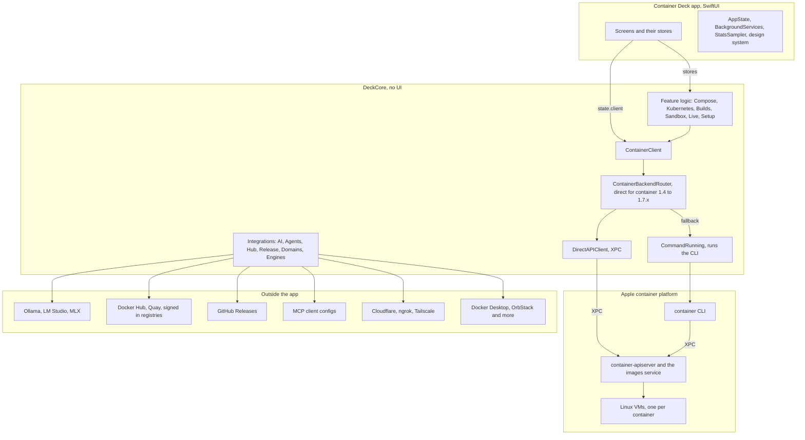
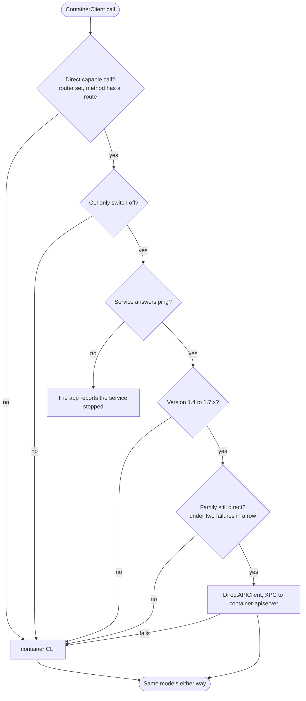
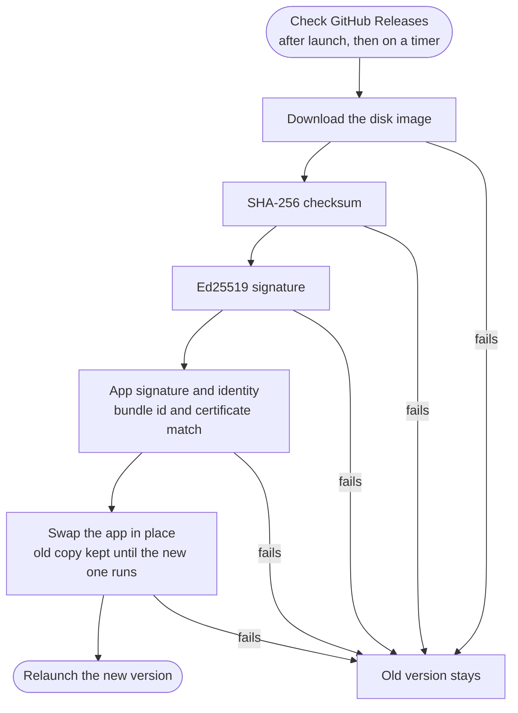

# Architecture

Container Deck is a native SwiftUI app for macOS 15 and later on Apple silicon. It manages containers, images, volumes, networks, Compose stacks and related tools on top of Apple's container platform. It has no server or helper daemon of its own. Everything it does goes either to the container service that Apple's platform already runs on the Mac, or to the `container` CLI.

This document describes how the code is organized and why. For the local HTTPS proxy and sharing, see [DOMAINS.md](DOMAINS.md).

## Overview

The app is built in layers. Screens call into DeckCore, and every platform call goes through `ContainerClient`. Its backend router sends the frequent calls straight to Apple's container service over XPC and everything else to the `container` CLI. The rest of DeckCore talks to the services and files outside the app: local model servers, Docker Hub and other image registries, GitHub Releases, the config files of MCP clients, tunnel tools and other container engines.

<!-- diagram: overview -->

## Constraints

A few decisions shape most of the code:

- Apple's platform is the source of truth. The app keeps no database of containers. Every screen shows what the container service reports right now, and every change goes back through it. If the user changes something in Terminal, the app picks it up on the next poll.
- Views never start a process or open a connection. All platform calls go through `ContainerClient` in DeckCore, which keeps the UI testable and keeps platform quirks in one place.
- The package is Swift tools 6.0 in Swift 5 language mode. The only third party dependency is [Yams](https://github.com/jpsim/Yams), for Compose files. XPC, TLS, certificates, update signing and the updater are built on system frameworks.
- Bad platform output must never crash the app. The `container` CLI's JSON has changed between releases, so parsers accept every shape we know about and fail with an error the user can read, not a crash.

## Modules

The Swift package has two targets and two test targets.

| Target | Role |
| --- | --- |
| `DeckCore` | A library with no UI. Calls the CLI and the direct API, parses output into models, and holds the logic for Compose, engine import, updates, domains, sandboxes and the rest. System frameworks only (Foundation, CryptoKit, Network, Security, XPC), plus Yams. |
| `ContainerDeck` | The SwiftUI executable. App state, background services, the design system and one folder per screen. |
| `DeckCoreTests` | XCTest suite for DeckCore with recorded CLI output, recorded XPC replies and mock runners. |
| `ContainerDeckTests` | Tests for app level logic: the design system, focus routing, the live feed and screen stores. |

### DeckCore

| Folder | Contents |
| --- | --- |
| `Platform/` | `CommandRunning` and `CommandStreaming` (process execution behind protocols), `ContainerCLILocator`, `PrivilegedRunner` (admin commands through the macOS password prompt), `SemanticVersion`, `DeckError`. |
| `Resources/` | `ContainerClient` (the single entry point for platform calls), `ResourceModels` (shared models), `ContainerOutputParser` (pure parsers for every JSON shape), `SystemConfigFile` (`~/.config/container/config.toml`). |
| `API/` | The direct XPC client, backend selection and CLI fallback. See [Sources/DeckCore/API/README.md](../Sources/DeckCore/API/README.md). |
| `Live/` | Pure helpers for live data: `PollSequencer`, `ListDiff`, `SubscriptionSet`, `StableOrder`, container grouping, stats math. |
| `Setup/` | First run checks and the platform installer. |
| `Compose/` | Compose file discovery, interpolation, parsing, planning and running. Shared by the app and the `container compose` CLI plugin (`Sources/ContainerCompose`). Supported keys and CLI usage are in [COMPOSE.md](COMPOSE.md). |
| `Engines/` | Import from Docker Desktop, OrbStack, Rancher Desktop, Podman and Colima. |
| `Release/` | Update checking, download, signature and certificate checks, the install script, and the rule for compulsory updates (`UpdateRequirement.swift`). |
| `Domains/` | Local HTTPS proxy, certificate authority, alias DNS responder, port redirect and tunnels. |
| `Builds/`, `Kubernetes/`, `AI/`, `Sandbox/`, `Agents/`, `Registry/`, `Hub/`, `Observability/`, `Palette/`, `Polish/` | Feature logic for the matching screens. |
| `Config/` | `AppConfig`: product names, links, colors, update settings and defaults in one file. |

Feature folders usually extend `ContainerClient` in a file named `ContainerClient+<Feature>.swift`, so all platform calls stay on one type without that type growing into one large file.

### ContainerDeck

| Folder | Contents |
| --- | --- |
| `App/` | `ContainerDeckApp` (scenes), `AppState`, `Prefs`, `BackgroundServices` (shared container feed, notifications, updates), `StatsSampler`, `AppActivity`, `LiveRefresh`, `DeepLinkRouter`, `DebugAutomation`. |
| `DesignSystem/` | `DeckIcon` (the SF Symbol map), `Components` (tokens and shared views), form helpers. |
| `Brand/` | Logo, lockup, company logo and menu bar image. |
| `Features/<Screen>/` | One folder per screen, usually a view plus an `@Observable` store. |

## Talking to the platform

`ContainerClient` is a `Sendable` struct that wraps the path to the `container` binary, a `CommandRunning` and a `CommandStreaming`. Every method maps to one CLI command or a short sequence of them, and returns models from `ResourceModels.swift`. It also exposes the exact command line for an action (`commandLine(_:)`), which the UI shows as a copyable hint so users can learn or script the same thing.

The binary is found by `ContainerCLILocator`: a custom path from Settings first, then `/usr/local/bin/container` and `/opt/homebrew/bin/container`, then `PATH`.

Commands that need admin rights, such as creating a DNS domain, go through `PrivilegedRunner`. It runs them with `osascript` and `with administrator privileges`, so macOS shows its own password prompt. The app never runs as root and never stores a password.

Where the CLI lacks something, the client fills the gap without changing the interface. `container system property set` was removed in 1.0, so `setSystemProperty` writes `config.toml` directly and the service picks it up on restart. File copy falls back to tar over `exec` on CLIs without `container copy`.

## Direct API and CLI fallback

Polling the container list and stats through the CLI means starting a process every second, and `container stats --no-stream` alone takes about two seconds. Container Deck instead talks to the container service over XPC for its most frequent calls: lists, inspect, start, stop, kill, delete, stats, logs, image list, inspect, tag and delete, volumes, networks and disk usage. A list call takes a few milliseconds and spawns nothing.

The design keeps the CLI as the safety net:

- `ContainerClient` has an optional `router`. When it is set, direct capable methods hand the call to `ContainerBackendRouter`. Everything else stays on the CLI.
- `BackendSelector` uses the direct API only when the service answers a ping and its version is inside `AppConfig.apiSupportedVersions` (1.4.0 to any 1.7.x today). Outside that range, the whole app uses the CLI.
- A direct call that fails on the transport is retried through the CLI. Two such failures in a row move that family of operations to the CLI for the session.
- Creating and running containers always uses the CLI, because `container run` does substantial client side work that we do not want to duplicate.
- Settings has a switch that sends everything through the CLI, for support and comparison.

Each call goes through these checks in order. A "no" sends it to the CLI, except a stopped service, which the app reports as stopped. Both paths return the same models.

<!-- diagram: routing -->

`AppState` creates one router per session and every `state.client` is routed through it, so connections, the ping cache and fallback counts are shared. The full routing table, the fallback rules and the known differences from the CLI are in the [API README](../Sources/DeckCore/API/README.md).

### Differences between container releases

Apple's releases inside the supported range behave differently in a few places, mostly around Kubernetes: 1.7 hides cluster nodes from `container list`, refuses start and stop on them, prints `cluster list` per cluster with a JSON form, drops `cluster load-image` and recommends a newer kernel. `ContainerPlatformFeatures` in `DeckCore/Platform` lists every such difference by version, and code asks it instead of comparing version numbers. The version comes once from the setup report (`ContainerClient.platformVersion`), or for the direct path from the daemon's ping. A release newer than any tested gets the newest known behaviour, and a failure there says the release is newer than tested. The table per release is in the API README.

## Live data

Many screens show the same live information. Rather than letting each screen poll, the app has two shared sources and one pattern for everything else.

### The shared container feed

`BackgroundServices.shared` runs the only container list loop in the app. Dashboard, Containers, Compose, the menu bar panel, the container detail header and the usage columns in Images, Volumes and Networks all read `BackgroundServices.shared.containers`.

The loop paces itself by who is looking. `AppActivity` tracks whether a main window is visible (not minimized, hidden or covered) and whether the menu bar panel is open.

| Activity | Direct API | CLI |
| --- | --- | --- |
| A window is visible | 1 s | The Refresh setting, 3 s by default |
| Only the menu bar panel is open | 3 s | At least 5 s |
| Nothing is visible | 10 s | 10 s |

The background pace keeps crash alerts working while the app sits in the menu bar. After each poll, the loop reads `client.backendStatus()`. If the backend changes, because of a fallback, the Settings switch or a daemon update, the loop re-paces and the stats sampler switches mode.

Each poll takes a token from a `PollSequencer`, so a slow manual refresh can never overwrite a newer result. The list is published only when it actually changed, which keeps SwiftUI from re-rendering every screen once a second. The same loop detects containers that stopped without the user asking, posts a notification, and starts containers marked for auto start.

`AppState.resourcesChanged()` is the one call a screen makes after it changes anything. It bumps `resourcesVersion`, which screens use as a `.task(id:)` key, and asks the feed to poll immediately.

### The stats sampler

`StatsSampler.shared` produces CPU, memory, network and disk readings for every running container. It is reference counted: a view that shows stats adds `.usesLiveStats("owner", active:)`, and the sampler runs only while at least one such view is on screen and the app is visible. When the last subscriber leaves, it waits one second before stopping so a quick tab switch does not restart it.

With the direct API it calls `client.stats([])` about every 1.5 seconds, which samples all running containers in about 25 ms. On the CLI it keeps one long running `container stats` process in its streaming table mode, which prints a frame about every 2.2 seconds. If that table cannot be read, it falls back to repeated `stats --no-stream --format json` calls. In every mode, CPU percent is computed from consecutive samples by `StatsTracker`, where 100 percent means one full core. Dashboard, the Containers list, the Stats tab and the menu bar panel all read the same readings and history.

### Other lists

Images, Volumes, Networks, Machines and similar screens load on appear and use `.autoRefresh { await load() }` from `LiveRefresh.swift`. It reloads every 10 seconds while the main window is visible and once when the app becomes active, so a change made in Terminal shows up without pressing Refresh. Screens assign the new list only when it differs and use a `PollSequencer` to drop stale loads.

## App state and navigation

`AppState` is a `@MainActor @Observable` object injected into the environment. It holds the setup report, the current sidebar selection, toasts, and cross screen requests. Views read it with `@Environment(AppState.self)`.

Screens navigate by setting state, never by posting notifications. `state.openContainer(id, tab:)` selects Containers and sets a focus request that the Containers screen and the container detail consume once the detail is on screen. This is what makes a deep link work on a cold start, when the target screen does not exist yet. Compose stacks, images and machines work the same way.

The command palette, `containerdeck://` deep links (`DeepLinkRouter`) and notification clicks all go through these same calls. Errors go to `state.showError(error)`, which records the error for Diagnostics and shows a toast.

Settings live in `UserDefaults` under keys defined in one place, `PrefKey` in `App/Prefs.swift`. Views bind with `@AppStorage(PrefKey.x)`. Product values that are not user settings, such as names, links, colors and the supported API range, live in `AppConfig.swift`, which the build scripts also read.

## Design system

All shared styling lives in `Sources/ContainerDeck/DesignSystem/`. Screens use these pieces instead of building one off styles, which is what keeps the app consistent in Light and Dark mode.

Colors come from `DS` tokens (`accent`, `surface`, `surfaceRaised`, `textPrimary`, `textSecondary`, `running`, `warning`, `danger` and so on). Each token is a Light and Dark pair defined in `AppConfig.Theme`. Brand crimson (`#B3122E` in Light, `#D3263F` in Dark) is the only accent. The bundle also ships an asset catalog with the brand `AccentColor`, so AppKit controls and sidebar selection match.

Icons are SF Symbols, so nothing is bundled. `DeckIconName` in `DeckIcon.swift` maps every icon the app uses to one symbol and a tone: solid, two tone with one layer in crimson, or a status mark on a colored disc. Screens never call `Image(systemName:)` directly. They use `DeckIcon(.name)`, `DeckLabel("Title", icon: .name)` or `Image.deck(.name)`, so any icon can be changed in one place. `DeckIconTests` checks that every symbol exists on macOS 15, that two tone icons really have a second layer, and that no two icons share a symbol.

The main components:

| Component | Use |
| --- | --- |
| `Card`, `.deckCard()` | Card surface with an optional title row. |
| `MetricTile` | Number tile for dashboards. |
| `Pill`, `StatusPill` | Small tinted capsule, and container state with a colored dot. |
| `EmptyState`, `LoadingView` | Empty, not ready and loading states. |
| `SectionHeader`, `KeyValueRow` | Section titles with optional controls, and label and value rows for detail panes. |
| `CommandHint` | The equivalent CLI command with a copy button. Hidden when the user turns hints off. |
| `SegmentedFilter`, `RefreshButton` | Filter tabs with counts, and a toolbar refresh button with a spinner. |
| `DeckPage`, `EqualHeightRow`, `ListStatusBar`, `SheetScaffold` | Page layout, rows of cards with equal height, the status line under tables, and the standard sheet frame. |
| `.deckPrimary()`, `.confirmDelete(...)` | The primary crimson button style, and the standard delete confirmation. |

## Image search

Images, Explore searches every registry at once through `RegistrySearchService` (DeckCore `Registry/`). Docker Hub and Quay.io use their public search APIs. ghcr.io has no public search, so with the saved token the GitHub Packages API lists the user's and their orgs' container packages. Any other signed in registry gets Harbor's `/api/v2.0/search` when it is a Harbor, else `/v2/_catalog` filtered locally. ECR and Google Artifact Registry only offer the exact name lookup. Tags come from Docker Hub's and Quay's tag APIs, else from `/v2/<name>/tags/list` with the standard `WWW-Authenticate` bearer flow. Each registry has its own time limit.

`container registry login` keeps each login in the login keychain as an internet password with security domain `com.apple.container.registry`, server set to the resolved host and account set to the user name. Its access list trusts only the `container` tool. The app reads a login quietly with keychain prompts turned off, so a search never shows a prompt, and only asks macOS when the person presses Allow Access. Logins stay in memory and are never written or logged.

## App lifecycle

The app declares three scenes: the main window, Settings and a `MenuBarExtra` panel.

On first appearance, `BackgroundServices.start(state:)` starts the container feed, notification handling, update checks, the stats history recorder, and the HTTPS proxy if the user enabled it at launch. It is safe to call more than once.

Closing the last window keeps the app running in the menu bar and hides the Dock icon. Opening a window brings the Dock icon back unless the user hid it in Settings. Open at login (through `SMAppService`) starts the app hidden. Quitting from the panel asks first and explains that containers keep running, since they belong to Apple's container service and not to the app.

Only one copy runs at a time. `Info.plist` sets `LSMultipleInstancesProhibited`, and a launch check also catches a second copy in another folder, brings the running one forward and quits.

About 8 seconds after launch, and then every `AppConfig.updateCheckInterval`, the app checks GitHub Releases for a newer version if the user allows it. Updates are verified and installed by the app itself: it downloads the disk image, checks its SHA-256 checksum and Ed25519 signature, confirms the bundle id and signing certificate match the running app, swaps the app in place and relaunches. If any step fails, the old version stays.

<!-- diagram: update -->

Under `swift run` there is no app bundle, so notifications, the login item and deep links are unavailable and the Dock icon is loaded from `assets/brand/app-icon-1024.png`. Use `scripts/bundle.sh` to test those features.

## Engine import

Engine import brings images from Docker Desktop, OrbStack, Rancher Desktop, Podman and Colima into Apple's container platform. The code is in `DeckCore/Engines/` and `Features/Import/`.

Images that came from a registry are pulled again with `container image pull`. That is fast, keeps every platform variant and needs no other engine running. Local builds, and pulls that fail, are exported from the engine (Docker API `/images/get`, `nerdctl save` or `podman save`), converted to an OCI layout archive by `OCIArchive`, and loaded with `container image load`.

Users should not have to open another engine just to import from it. Every engine keeps its images inside a Linux VM disk that macOS cannot read safely, so reading a stopped engine from disk is not an option. Instead, when export is needed, Container Deck starts the engine headless, uses its own API and stops it again. The rules, in `EngineSession` and `StoppedEngineWorkflow`, are strict because leaving someone's engine running, or changing its settings, would be a real cost to them:

- If the engine already answers, use it and never stop it.
- Record "we started it" before the first start command, so a cancel or failure partway through still stops it.
- Each engine has a start time limit, between 90 and 240 seconds. A start command that hangs is killed at the limit.
- Wait until the engine has finished starting before stopping it. Some engines treat an early stop as a crash and restart.
- Always stop an engine we started, after success, error or cancel, in a detached task that a canceled import cannot cut short. Retry and confirm, since some engines come back right after a stop.
- Undo any setting the start changed, and quit the engine's app only if it was not running before.
- On app quit, stop any engine we started and have not stopped yet.
- Check free disk space before anything starts.

The start, stop and status commands per engine are in `EngineControlPlanner` and are unit tested.

## Kubernetes

Local clusters come from Apple's experimental `container cluster` plugin, which runs each Kubernetes node (a kindest/node image bootstrapped with kubeadm) as a container. The code is in `DeckCore/Kubernetes/` and `Features/Kubernetes/`. Cluster lifecycle uses the CLI. Reads, logs and actions inside a cluster use a small REST client (`KubeAPIClient`) with the credentials from a private kubeconfig that the app writes with `cluster write-config`. kubectl is used only for port forwards and for applying manifests, and is never installed by the app.

### Start and stop

The plugin has no start or stop command, so the app stops and starts the node containers itself (workers first on stop, control plane first on start). Up to 1.6.1 that uses the normal container calls. From 1.7 the CLI answers "not found" for cluster nodes, so the app sends start and stop straight to the container service (`ContainerBackendRouter.clusterNode`), which still accepts them. On 1.7 the cluster list merges the nodes (direct list on the plugin label) with the records of `cluster list --format json`, which carry the shared image store setting and keep a cluster whose nodes are gone visible so it can be deleted. Clusters made by 1.6.1 have no record and show from their nodes alone. `cluster load-image` is gone in 1.7: a cluster made with Share this Mac's image store reads local images directly, and for the others the app saves the image, copies it into each node and imports it with containerd's `ctr`. Releases 1.4 to 1.6.0 ship the same plugin as `container k8s` (nodes labelled `k8s`, one node, no workers), and `ContainerPlatformFeatures.clusterCommand` picks the name. Cluster nodes always count as image users (`ContainerClient.imageUsers()`, also on 1.7 where `container list` hides them), and the app prunes images itself, since `container image prune` removes the untagged `kindest/node` image under a live cluster. Each start gives a node VM a new IP address. The plugin's node entrypoint rewrites the old address in the control plane's files and issues a new API server certificate, but it leaves three things stale:

- ConfigMap `kube-system/kube-proxy` still points kube-proxy at the old address. kube-proxy cannot sync, so no Service rules exist and the in-cluster API address `10.96.0.1` does not answer. kindnet reads nodes through that address, so kindnet applied after a restart never writes its CNI config and the node stays NotReady (its log ends at "Waiting for the policy engine to become ready"). A cluster created with kindnet still reports Ready because the old CNI config is on disk, but DNS and every Service are down.
- ConfigMap `kube-public/cluster-info` keeps the old address for `kubeadm join`.
- Workers keep the control plane's old address in `/etc/kubernetes/kubelet.conf`.

The kernel settings from the plugin's node preparation (`net.ipv4.ip_forward` and the TCP MSS clamp rules) are also lost on reboot.

`KubeRestartRepair` handles this. A read only probe runs in each node with `container exec` and reports these values. `KubeRestartRepair.plan` turns the probes into the steps that are actually needed, and each step is a short shell script run in the right node. The plan is empty on a healthy cluster, so the repair is safe to run at any time. The app runs it after every Start (`startClusterAndRepair`) and before Apply kindnet. A cluster started outside the app is checked once per control plane address, and the overview offers Repair Network when its addresses are stale. The probe and plan logic is tested with output recorded from real clusters (`KubernetesRestartTests`).

### Log streaming

Pod logs with follow do not use URLSession. URLSession holds back the first 512 bytes of a `text/plain` response, so a quiet pod's new lines arrived late. `KubeHTTPStream` speaks HTTP/1.1 over Network.framework with the same TLS material as the REST client (`KubeTLS`: the cluster CA as the only trust anchor and the client certificate identity built in memory) and hands each chunk on as it arrives. `KubeHTTPDecoder` (chunked, fixed length and read until close) and `KubeLineSplitter` are pure and tested with arbitrary byte splits. A follow stream asks for timestamps and strips them. When the connection drops, `KubeLogFollower` reconnects with `sinceTime` set to the last timestamp and skips lines it has already shown. A clean end of the stream, such as a container exiting, does not reconnect.

## Chat history

Chat history lives in container volumes. AI Models uses one volume, `deck-chat-history` (label `deck.role=chat-history`). Each sandbox has `<name>-chat` (labels `deck.sandbox=<name>`, `deck.role=chat-history`), made with the sandbox and mounted read write at `/deck/chat` so an agent inside can read it. Sandboxes made before this get theirs the first time their chat needs it, read through a helper, never by recreating the sandbox. The JSON files in `Application Support/<bundle id>/AI/chats/` (`models/` and `sandboxes/<name>/`) are only a speed cache of what is in a volume: screens read and write the cache instantly, and `ChatSyncCenter` moves changes to the volume a few seconds later in one round trip (`ChatVolumeSync` in DeckCore). A round trip is one short lived `--rm` helper container (`alpine`, label `deck.helper=chat-sync`) that mounts the volume, or `container exec` when a running sandbox already mounts it. It writes the queued files from stdin (base64), then lists every file back, and the volume wins on merge. The first sync copies files from before volumes into the volume. "Save chat history" (Settings for AI Models, New Sandbox and the sandbox Chat tab menu) is on by default. When it is off, or the volume was removed, nothing is saved, the cache for that chat is deleted, and the chat shows a notice with Turn On, Create Volume or Attach Volume. A missing volume is only made automatically on first use, so a volume someone removed stays removed. When the container service is stopped, new messages stay in memory with a notice, are written when the service comes back while the app runs, and are lost if the app quits first. Removing a sandbox removes its chat volume unless the person picks "Remove, Keep Chat History". API keys are never written to chat files.

## Testing strategy

`swift test` must pass on any Mac with the toolchain, with or without Apple's container platform installed. That rules out calling the real CLI in normal tests, so DeckCore tests replay recorded output instead:

- `MockRunner` (in `SetupServiceTests.swift`) implements `CommandRunning`, records every call and returns canned output. Tests assert both the parsed result and the exact arguments sent to the CLI.
- Fixtures are real output captured from the `container` CLI and from the container service (`Tests/DeckCoreTests/Fixtures`). When the CLI changes its JSON, a new fixture is added next to the old one so both shapes stay supported.
- `FakeTransport` stands in for XPC, so the direct client, the selector and the router are tested for timeouts, cancellation and every fallback rule.
- Logic that would normally live in views, such as diffing, stable ordering, grouping, stats math and palette ranking, sits in DeckCore as pure functions so it can be tested without SwiftUI.

Tests that touch the real system are opt in through environment variables such as `DECK_REAL_CLI=1` or `DECK_LIVE_DOMAINS=1`. They create resources with a `deck-test-` prefix and clean up after themselves. [CONTRIBUTING.md](https://github.com/sur950/container-deck/blob/main/CONTRIBUTING.md) lists them all.

For UI work, start the app with `DECK_AUTOMATION=1`. It then accepts commands as distributed notifications (`App/DebugAutomation.swift`), including `select:<screen>`, `appearance:<mode>`, `size:WxH`, `link:<deep link>` and `snap:<png>`, which writes the app's own windows to a PNG without Screen Recording permission. Set `DECK_AUTOMATION_ID=<id>` to run several copies side by side. This makes it practical to check every screen in Light and Dark mode from a script.

## Extension points

| Change | Where it goes |
| --- | --- |
| A new CLI call | A method on `ContainerClient`, or in a `ContainerClient+<Feature>.swift` extension. Parse output in `ContainerOutputParser` or a feature parser as a pure function, and add a test with recorded output that checks both the arguments and the parsed model. |
| A new direct API route | Follow "Adding a route" in the [API README](../Sources/DeckCore/API/README.md). Every direct route needs a CLI fallback and parity with the CLI path. |
| A new screen | A case in `SidebarItem` (`Features/Shell/RootView.swift`), a folder under `Features/`, and a store if the screen has state. Read containers from `BackgroundServices.shared`, use `.usesLiveStats` for stats and `.autoRefresh` for other lists, and do not start a separate polling loop. Add a name in `DeepLinkRouter` if the screen should be reachable from links. |
| A new icon | A case in `DeckIconName` with a symbol that exists on macOS 15. `DeckIconTests` catches a missing or duplicate symbol. |
| A new setting | A key in `PrefKey`, its default in `Prefs.registerDefaults()`, and `@AppStorage` in the view. |
| A product value | `AppConfig.swift`. Names, links, colors, update settings and the supported API range live there, and the build and release scripts read the same file, so a rename never touches a script. |

## Related guides

- [COMPOSE.md](COMPOSE.md): Compose support, key by key, and the `container compose` command.
- [DOCKER.md](DOCKER.md): using Docker commands with Apple's container, including the `docker` compatibility command in `contrib/docker`.
- [DOMAINS.md](DOMAINS.md): local domains, the HTTPS proxy and sharing to the internet.
